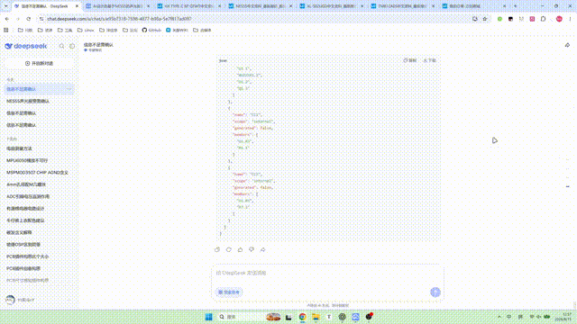
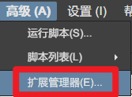
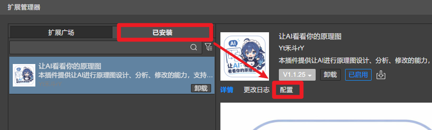
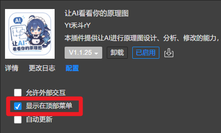

[简体中文](./README.md) | [English](./README.en.md)

面向希望让 AI 整体/局部分析或修改原理图，但是不想配置插件和 API 还有不想消耗 Token 的用户，本插件提供了让 AI 进行原理图设计，原理图分析，原理图修改的能力，支持任意 AI 工具，包括网页版的 AI 工具。

> 已有使用该插件完成原理图设计并进行打板验证的PCB项目

## 使用场景

1. 可以一键导出 AI 分析提示词+框选电路的连接关系，让用户给任意 AI 工具进行分析。
2. 支持连接关系的反向导入，用户可以直接导入 AI 工具生成的内容，来生成原理图，引脚只生成网络标签，保证原理图的美观性。
3. 提供**让 AI 设计**、**让 AI 分析**、**让 AI 修改**的一键复制提示词，直接粘贴给 AI 即可使用。

## 功能演示

以下视频展示了插件的反向导入功能，插件只生成网络标签，确保原理图整体的简洁、美观。

## 插件能力

1. 导出连接关系：生成当前框选电路的连接关系。

2. 导入连接关系：根据导入的连接关系修改框选部分的电路。
3. 撤回上一次的导入：如果对上一次的导入修改的电路不满意，可以直接撤回。
4. 与AI联动：提供**让 AI 设计**、**让 AI 分析**、**让 AI 修改**的一键复制提示词，自动填充框选电路的连接关系。

## 如何使用

1. 在嘉立创EDA顶部的菜单栏中选择**高级**，然后点击**拓展管理器**。

2. 进入**拓展广场**后搜索**让AI看看你的原理图**，点击**安装**。

3. 安装完成后点击**已安装**，选择**让AI看看你的原理图**，然后点击右侧的配置。

4. 勾选**显示在顶部菜单**，此时回到原理图界面，在顶部菜单栏就可以看到**让AI看看你的原理图**的选项。

### 让 AI 进行原理图设计

1. 点击顶部菜单栏中的**让AI看看你的原理图**，选择**与AI联动**。

2. 一键复制提示词，并根据需要填空，然后发给 AI。

3. AI 会进行设计确认，确认完成后会给出器件清单，你需要根据清单中的参数，自行进行器件挑选与放置。

4. 器件放置完成后，框选所有器件并**导出连接关系**，然后再次发给 AI。
5. 此时 AI 应该会回复连接关系但是也有可能会提出问题，持续回复直到回复连接关系后，复制后**导入连接关系**，检测成功后插件就会自动开始原理图的绘制。

### 让 AI 进行原理图分析

1. 框选需要让 AI 分析的部分，点击顶部菜单栏中的**让AI看看你的原理图**，选择**与AI联动**，然后点**让 AI 分析**，将内容直接复制给 AI 即可。

### 让 AI 进行原理图修改

1. 框选需要让 AI 分析的部分，点击顶部菜单栏中的**让AI看看你的原理图**，选择**与AI联动**，然后点**让 AI 修改**，将内容直接复制给 AI。
2. AI 回复连接关系后，复制后**导入连接关系**，检测成功后插件就会自动开始原理图的绘制。

## 实践案例

项目开源链接如下，已进行打板验证：

https://oshwhub.com/t0k0m/project_fjjeygwy

## 关于

插件源码地址：

https://github.com/2549850807/Let-the-AI-look-at-the-schematic

欢迎大家尝试使用本插件，如果觉得有用的话，麻烦给个 5 星好评，喵~

如果有遇到 BUG 或者觉得哪里可以改进的话，欢迎在 Github 上提交，或者直接在评论区评论，谢谢大家。
